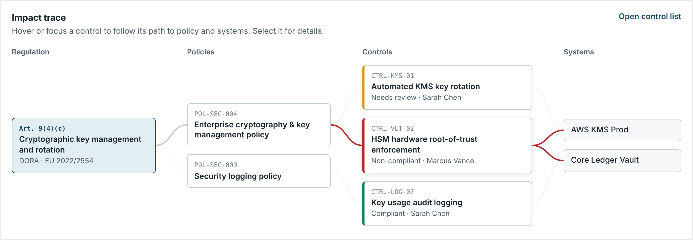
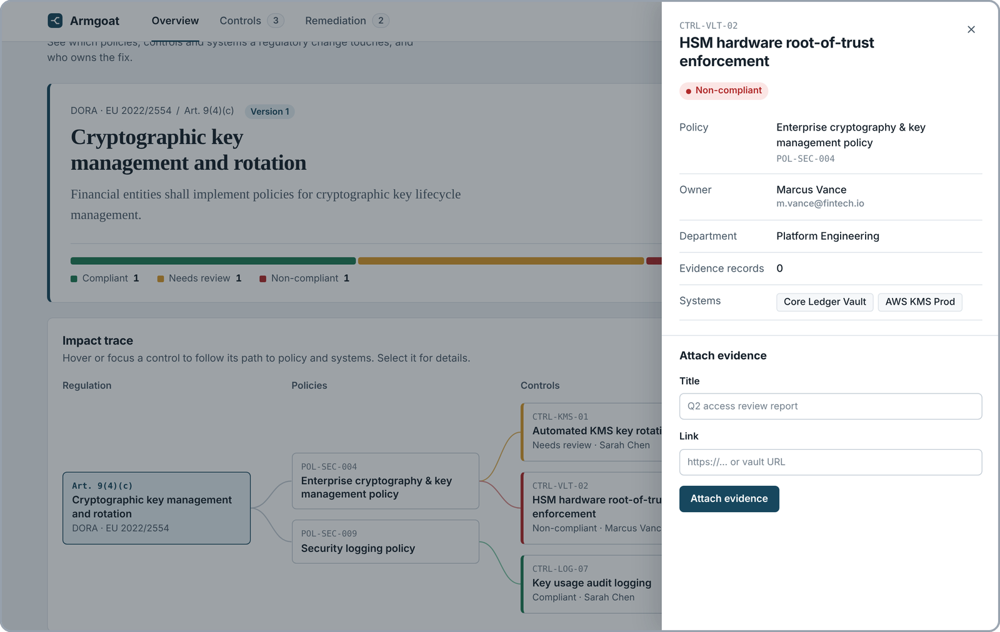
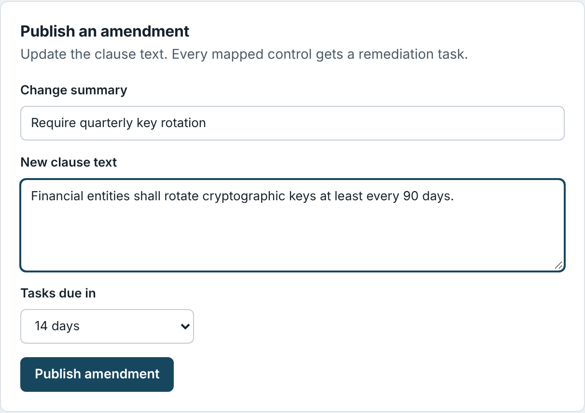
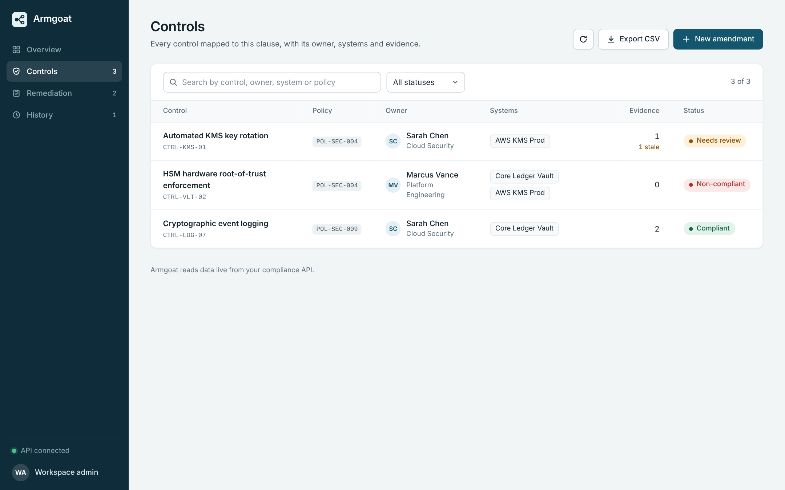
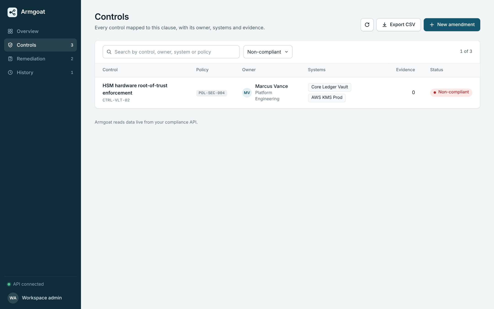
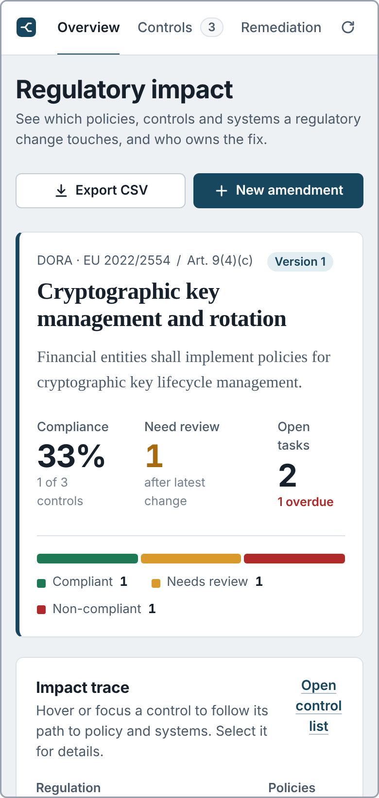
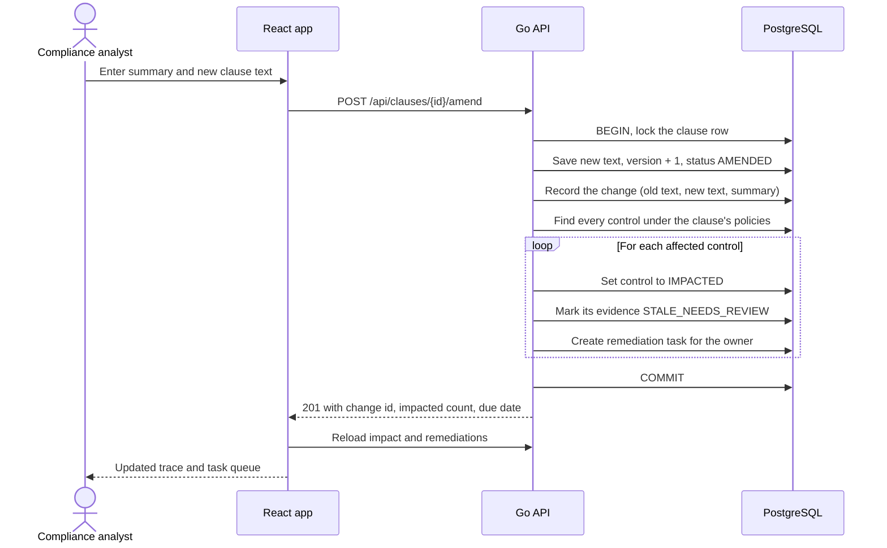
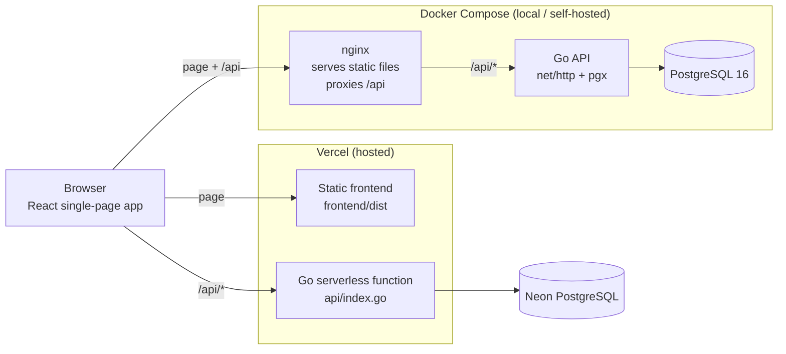
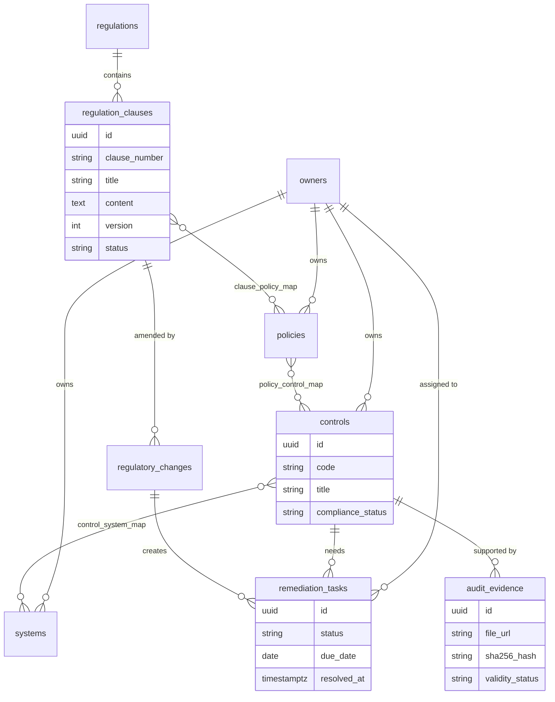

# Armgoat

**Regulatory change impact tracking for compliance teams.**

When a regulation changes, Armgoat shows which policies, controls and systems it touches, creates a remediation task for every affected control owner, and tracks the work until each control is compliant again.

<p align="center"></p>

## Contents

1. [Project overview](#1-project-overview)
2. [Features](#2-features)
3. [Demo](#3-demo)
4. [How it works](#4-how-it-works)
5. [System architecture](#5-system-architecture)
6. [Data model](#6-data-model)
7. [Tech stack](#7-tech-stack)
8. [Getting started](#8-getting-started)
9. [Deployment](#9-deployment)
10. [API reference](#10-api-reference)
11. [Project structure](#11-project-structure)
12. [Configuration](#12-configuration)
13. [Design notes](#13-design-notes)
14. [Known limitations and roadmap](#14-known-limitations-and-roadmap)
15. [Troubleshooting](#15-troubleshooting)

---

## 1. Project overview

### The problem

Regulations such as DORA, GDPR and SOC 2 are written as clauses. Companies meet them through internal policies, which are enforced by controls, which run on specific systems. When a clause is amended, someone has to work out what that change affects and who needs to act. In many teams this lives in spreadsheets and email threads, and things get missed.

### What Armgoat does

Armgoat keeps that chain connected:

```
Regulation clause  →  Policy  →  Control  →  System
                                    │
                                    └──  Owner (responsible person)
```

Publish an amendment to a clause and Armgoat:

1. Records the change, including the previous and new text.
2. Marks every downstream control as *needs review*.
3. Marks the control's existing audit evidence as stale until someone re-verifies it.
4. Creates a remediation task for each control owner, with a due date.

As owners close their tasks, controls return to *compliant* automatically.

### Who it is for

Risk, compliance and security teams, especially in regulated industries such as financial services, who need a clear answer to "what does this change affect, and who owns the fix?"

---

## 2. Features

| Feature | What you can do |
|---|---|
| **Impact trace** | See a clause flow through its policies and controls to the systems they protect. Hover or focus a control to highlight its full path. |
| **Amendments** | Publish new clause text with a change summary and a due-date window (7, 14, 30 or 60 days). |
| **Automatic remediation** | Every affected control gets a task assigned to its owner. |
| **Control library** | Search by control, owner, system or policy. Filter by status. Export the current view as CSV. |
| **Remediation queue** | Move tasks through Open, In progress, In review and Closed. Overdue tasks are flagged. |
| **Audit evidence** | Attach evidence (title and link) to a control. Each record gets a SHA-256 fingerprint. |
| **Live status** | A header indicator shows whether the API is reachable. Errors say what failed. |
| **Responsive** | Works from phone to desktop. Keyboard focus is visible, and reduced-motion settings are respected. |

---

## 3. Demo

Screenshots use sample data.

### Overview

The active clause with its version, the compliance score, how many controls need review, open and overdue tasks, and a status bar across all mapped controls.

<p align="center"></p>

### Impact trace

Regulation → policies → controls → systems. Control cards are colored by status, and links take the color of the control they belong to.

<p align="center"></p>

### Impact trace with a control in focus

Hovering or focusing a control fades everything else and highlights its path from the clause to the systems it runs on.

<p align="center"></p>

### Control details

Select any control to see its policy, owner, department, systems and evidence count, and to attach new evidence. Press Escape to close the panel.

<p align="center"></p>

### Publish an amendment

Enter a change summary, the new clause text and a due-date window. Publishing creates a task for every affected control.

<p align="center"></p>

### Control library

Every control mapped to the clause, with policy, owner, systems, evidence count and status.

<p align="center"></p>

### Control library, filtered

Search and status filters narrow the table. Export CSV downloads exactly what is shown.

<p align="center"></p>

### Remediation queue

Tasks created by amendments, with owner, due date and a status selector. Overdue tasks are marked in red.

<p align="center"></p>

### Mobile layout

<table>
<tr>
<td width="300"></td>
<td valign="middle">

The same views on a phone. Tabs stay reachable and the impact trace scrolls sideways.

The header collapses to the tabs and a refresh button. Buttons span the full width, and tables scroll sideways instead of squeezing.

</td>
</tr>
</table>

### API unreachable

If the API can't be reached, the header turns red and a message names the failure. The page stays usable.

<p align="center"></p>

---

## 4. How it works

### Publishing an amendment

All of this happens in a single database transaction, so a failure leaves nothing half-applied.



### Control and task status

| Event | Control status | Task status |
|---|---|---|
| Amendment published | Compliant → **Needs review** | **Open** task created |
| Task moved to In progress or In review | Stays **Needs review** | In progress / In review |
| Last open task for the control is closed | Back to **Compliant** | **Closed** |
| A closed task is reopened | Back to **Needs review** | Open / In progress / In review |

In the interface, the stored status `IMPACTED` is shown as **Needs review**.

---

## 5. System architecture

### Runtime view



Both deployments run the same API code. The Docker server (`backend/main.go`) and the Vercel function (`api/index.go`) both call `app.NewHandler` from `pkg/app`.

### Layers

| Layer | Responsibility | Where |
|---|---|---|
| **Presentation** | Views, tables, impact trace diagram, forms | `frontend/src/` |
| **API** | Routing, validation, transactions, business rules | `pkg/app/` |
| **Persistence** | Relational schema with many-to-many lineage tables | `db/schema.sql` |
| **Entry points** | Docker server and Vercel function | `backend/main.go`, `api/index.go` |

### Key design decisions

- **Lineage as join tables.** Clause → policy → control → system links are many-to-many tables, so one control can serve several policies and one policy can answer several clauses. Impact is found with plain SQL joins.
- **Transactional amendments.** Publishing a change touches several tables. A transaction means it either fully applies or not at all, and the clause row is locked while it runs.
- **Immutable change history.** Each amendment stores the previous text, the new text and the summary in `regulatory_changes`.
- **One handler, two hosts.** Shared code lives in `pkg/app`, so running under Docker and on Vercel needs no duplicated logic.
- **No client-side state library.** The app is one page with a small amount of state. React hooks are enough.

---

## 6. Data model



### Status values

| Field | Values |
|---|---|
| Clause status | `ACTIVE`, `AMENDED`, `DEPRECATED` |
| Control compliance status | `COMPLIANT`, `IMPACTED`, `NON_COMPLIANT` |
| Task status | `OPEN`, `IN_PROGRESS`, `REVIEW`, `CLOSED` |
| Evidence validity | `VALID`, `STALE_NEEDS_REVIEW` |
| System criticality | `LOW`, `MEDIUM`, `HIGH`, `CRITICAL` |

### Sample data

`db/seed.sql` loads one worked example:

- **Regulation:** DORA (EU 2022/2554), clause *Art. 9(4)(c), Cryptographic Key Management and Rotation*
- **Policy:** POL-SEC-004, Enterprise Cryptography and Key Management Policy
- **Controls:** CTRL-KMS-01 (Automated KMS Key Rotation) and CTRL-VLT-02 (HSM Hardware Root-of-Trust Enforcement)
- **Systems:** AWS KMS Prod and Core Ledger Vault
- **Owners:** Sarah Chen (Cloud Security) and Marcus Vance (Platform Engineering)
- **Evidence:** one record for the KMS rotation control

---

## 7. Tech stack

| Layer | Technology |
|---|---|
| Frontend | React 18, TypeScript, Vite |
| Styling | Hand-written CSS with design tokens. Public Sans and Newsreader fonts. |
| Backend | Go 1.22, standard library `net/http` router, `pgx` v5 |
| Database | PostgreSQL 16 |
| Container serving | nginx (static files and `/api` proxy) |
| Hosting options | Docker Compose, or Vercel with Neon Postgres |

---

## 8. Getting started

### Run everything with Docker

You need Docker with Compose.

```bash
docker compose up --build
```

| Service | URL |
|---|---|
| App | http://localhost:3000 |
| API | http://localhost:8080/api |
| PostgreSQL | localhost:5432 |

The schema and sample data load automatically on the first start. To reset the database:

```bash
docker compose down -v
docker compose up --build
```

### Run the frontend on its own

```bash
cd frontend
npm install
npm run dev
```

The app calls `/api/...`. Add a Vite proxy for `/api` to `http://localhost:8080` and run the API separately, or use Docker for the full stack.

### Build and check the Go code

From the project root:

```bash
go mod tidy
go build ./...
```

---

## 9. Deployment

### Option A: Docker (self-hosted)

Use `docker-compose.yml` on any machine with Docker. Set strong database credentials in `.env` first.

### Option B: Vercel and Neon

Vercel serves the frontend and runs the API as a Go serverless function. Postgres comes from Neon.

1. **Create the database.** Add Neon Postgres, for example from the Vercel Marketplace. Load the schema and sample data once:
   ```bash
   psql "<neon-connection-string>" -f db/schema.sql
   psql "<neon-connection-string>" -f db/seed.sql
   ```
   Run each file once, schema first. You can also paste them into Neon's SQL Editor.
2. **Commit `go.sum`.** Run `go mod tidy` locally and commit the result.
3. **Import the repository in Vercel.** Leave the root directory as the repository root.
4. **Set `DATABASE_URL`** under Settings, Environment Variables. Use Neon's pooled connection string, which ends in `sslmode=require`.
5. **Deploy**, then open `/api/remediations`. It should return JSON (an empty list is normal before any amendment).

`vercel.json` builds `frontend/` and routes `/api/*` to `api/index.go`. The function caps its connection pool at 3 so serverless instances don't exhaust the database.

---

## 10. API reference

All paths are under `/api`. Request and response bodies are JSON. IDs are UUIDs.

| Method | Path | Purpose |
|---|---|---|
| GET | `/clauses/{id}` | Current text, version and status of a clause |
| GET | `/clauses/{id}/history` | Every amendment with previous and new text and task progress |
| PATCH | `/controls/{id}/status` | Set a control to `COMPLIANT`, `IMPACTED` or `NON_COMPLIANT` (`409` if it still has open tasks and you pick compliant) |
| GET | `/controls/{id}/evidence` | List evidence attached to a control |
| PATCH | `/evidence/{id}/verify` | Re-verify stale evidence |
| GET | `/clauses/{id}/impact` | Controls, policies, owners, systems and evidence counts affected by a clause |
| POST | `/clauses/{id}/amend` | Publish an amendment and create remediation tasks |
| POST | `/controls/{id}/evidence` | Attach audit evidence to a control |
| GET | `/remediations` | List all remediation tasks |
| PATCH | `/remediations/{id}/status` | Move a task to a new status |
| PATCH | `/remediations/{id}/resolve` | Close a task |

### Examples

**Get the impact of a clause**

```bash
curl http://localhost:8080/api/clauses/11111111-1111-1111-1111-111111111111/impact
```

Returns one entry per control:

```json
[
  {
    "control_id": "33333333-3333-3333-3333-333333333333",
    "control_code": "CTRL-KMS-01",
    "control_title": "Automated KMS Key Rotation",
    "compliance_status": "COMPLIANT",
    "policy_code": "POL-SEC-004",
    "policy_title": "Enterprise Cryptography & Key Management Policy",
    "owner_name": "Sarah Chen",
    "department": "Cloud Security",
    "affected_systems": ["AWS KMS Prod"],
    "evidence_count": 1
  }
]
```

**Publish an amendment**

```bash
curl -X POST http://localhost:8080/api/clauses/11111111-1111-1111-1111-111111111111/amend \
  -H "Content-Type: application/json" \
  -d '{
    "change_summary": "Require quarterly key rotation",
    "new_content": "Financial entities shall rotate cryptographic keys at least every 90 days.",
    "due_days": 14
  }'
```

Returns `201`:

```json
{ "change_id": "…", "impacted_controls": 2, "due_date": "2026-12-09" }
```

`due_days` defaults to 14 when omitted.

**Update a task**

```bash
curl -X PATCH http://localhost:8080/api/remediations/<task-id>/status \
  -H "Content-Type: application/json" \
  -d '{ "status": "IN_PROGRESS" }'
```

Valid statuses are `OPEN`, `IN_PROGRESS`, `REVIEW` and `CLOSED`. Anything else returns `400`.

**Attach evidence**

```bash
curl -X POST http://localhost:8080/api/controls/<control-id>/evidence \
  -H "Content-Type: application/json" \
  -d '{ "title": "Q2 rotation report", "file_url": "https://…", "raw_content": "…" }'
```

Returns `201` with the evidence id and its SHA-256 fingerprint. The fingerprint is calculated from the link and the supplied content text. The file itself is not fetched or hashed.

### Errors

Errors return a plain-text message and a standard status: `400` for a bad ID or body, `404` when a clause or task doesn't exist, `500` for database failures.

---

## 11. Project structure

```
armgoat/
├── api/
│   └── index.go              Vercel serverless entry point
├── backend/
│   ├── main.go               Docker server entry point
│   └── Dockerfile
├── pkg/app/
│   ├── router.go             Routes and CORS, shared by both entry points
│   ├── handlers.go           Business logic and SQL
│   └── models.go             Response types
├── db/
│   ├── schema.sql            Tables, constraints and indexes
│   └── seed.sql              Sample DORA example
├── frontend/
│   ├── src/
│   │   ├── ImpactMapDashboard.tsx   Page state, data loading, views
│   │   ├── Lineage.tsx              Impact trace diagram
│   │   ├── components.tsx           Tables, badges, icons
│   │   ├── types.ts                 Shared types and helpers
│   │   ├── dashboard.css            Design tokens and styles
│   │   └── main.tsx
│   ├── nginx.conf            Static serving and /api proxy
│   └── Dockerfile
├── docs/screenshots/         Images used in this README
├── docker-compose.yml
├── vercel.json
├── go.mod
└── .env                      Local database credentials (not committed)
```

---

## 12. Configuration

| Variable | Used by | Purpose | Default |
|---|---|---|---|
| `POSTGRES_USER` | Docker Compose | Database user | `postgres` |
| `POSTGRES_PASSWORD` | Docker Compose | Database password | `postgres` |
| `POSTGRES_DB` | Docker Compose | Database name | `compliance_map` |
| `DATABASE_URL` | Go API, Vercel | Full connection string | Local Postgres |
| `PORT` | Go API (Docker) | API port | `8080` |

Copy `.env.example` to `.env` for local use. `.env` is git-ignored. Change the default credentials before running anywhere shared.

---

## 13. Design notes

The interface is built for people who scan for status and act on it, so it stays quiet and lets the data lead.

- **The impact trace is the centerpiece.** It shows the product's main idea, how a rule becomes work, in one view. The links are measured from the rendered cards, so they stay correct as content changes.
- **Regulation text is set in a serif.** Legal wording reads as a quotation, so it looks different from interface text.
- **Status never relies on color alone.** Every status has a text label as well as a color.
- **Plain language.** "Needs review" is shown instead of the internal "Impacted". Error messages say what failed.
- **Accessible by default.** Visible keyboard focus, labelled controls, dialog semantics on the details panel, and reduced-motion support.

---

## 14. Known limitations and roadmap

These are real gaps in the current version, listed so nobody is surprised.

**Limitations**

- **No authentication.** Anyone who can reach the API can read and change data, and CORS allows all origins. Add login and roles before using real compliance data.
- **One clause in the interface.** The clause ID and text are fixed in the frontend, and the version number is kept in the browser. A page reload shows the seeded clause again.
- **Non-compliant is never set automatically.** The status exists in the schema and interface, but no endpoint sets it. It can only be changed in the database.
- **Attaching evidence doesn't close tasks or refresh stale evidence.** Amendments mark evidence stale, but attaching new evidence doesn't change the status of older records or resolve a task.
- **Evidence fingerprints cover the link and text, not the file.** The file is not uploaded or checked.
- **No automated tests.**
- **No dev proxy.** `npm run dev` needs a manual `/api` proxy.

**Roadmap ideas**

- Authentication and role-based access
- A clause and regulation picker
- Evidence file upload with true content hashing, and re-verification that clears stale evidence
- A way to mark controls non-compliant
- Change history view showing the previous and new clause text
- Notifications for new and overdue tasks
- Automated tests for the API transactions and the frontend

---

## 15. Troubleshooting

| Symptom | Likely cause | Fix |
|---|---|---|
| Header shows "API unreachable" | The API isn't running or the host can't reach it | Check `docker compose ps`, or the Vercel function logs |
| `Impact API returned 500` | Database not configured, schema not loaded, or SSL setting wrong | Open `/api/clauses/11111111-1111-1111-1111-111111111111/impact` and read the error text |
| Error says `relation … does not exist` | Schema was never loaded | Run `db/schema.sql`, then `db/seed.sql` |
| Overview shows 0 controls and no errors | Sample data not loaded | Run `db/seed.sql` |
| `database is not configured` | `DATABASE_URL` missing | Add it in Vercel settings and redeploy |
| SSL errors on a hosted database | Connection string has `sslmode=disable` | Use `sslmode=require` |
| `go build` says no Go files | Built from the wrong folder or with `.` | Run `go build ./...` from the project root |
| Vercel build: `use of internal package` | Shared code was under `internal/` | It lives in `pkg/app`. Pull the latest code. |
| Fonts look different | Offline, so Google Fonts didn't load | The app falls back to system fonts |
