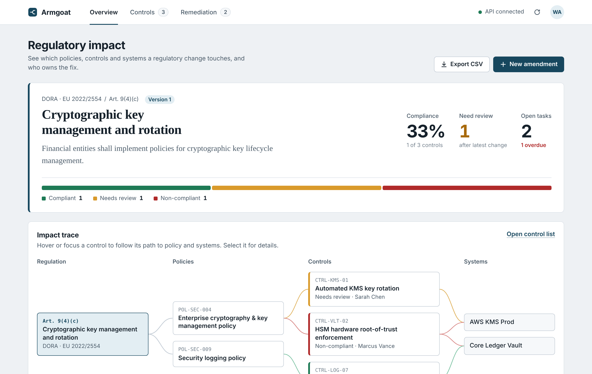
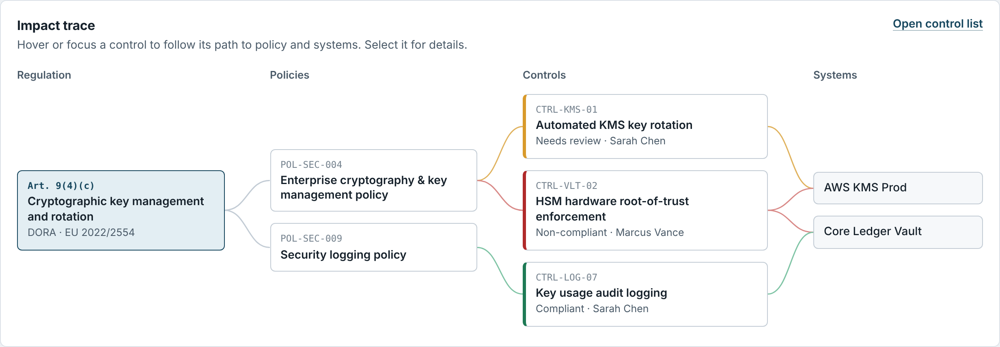
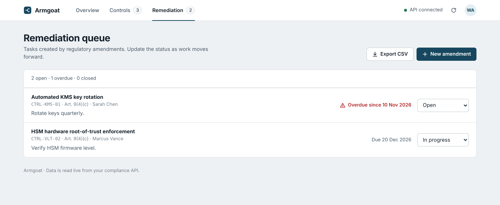
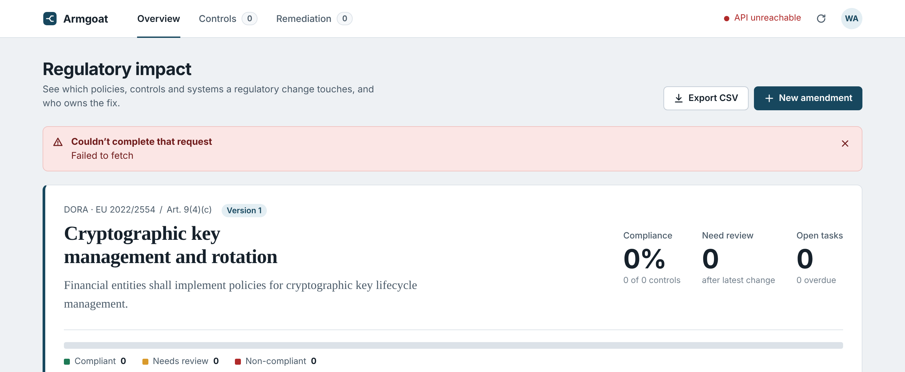

# Armgoat

A compliance workspace that answers one question: **when a regulation changes, what does it touch, and who has to fix it?**

Armgoat maps each regulatory clause to the policies, controls and systems that depend on it. When a clause is amended, every affected control gets a remediation task with an owner and a due date.



## Features

- **Impact trace.** See a clause flow through policies and controls to the systems they protect. Hover or focus a control to highlight its full path.
- **Amendments.** Publish new clause text and a change summary. Remediation tasks are created for every mapped control.
- **Control library.** Search and filter controls by owner, system, policy or status. Export the current view as CSV.
- **Remediation queue.** Track tasks through Open, In progress, In review and Closed. Overdue work is flagged.
- **Audit evidence.** Attach evidence to a control from its details panel. The backend hashes the record.

## Screenshots

| | |
|---|---|
|  |  |
| Impact trace: regulation to policies, controls and systems | A control in focus, with its path highlighted |
|  |  |
| Control details and evidence upload | Publishing an amendment |
|  |  |
| Control library | Filtered to non-compliant controls |
|  |  |
| Remediation queue | Mobile layout |

When the API can't be reached, the app says so and keeps the page usable:



Screenshots show sample data.

## Stack

| Layer | Technology |
|---|---|
| Frontend | React 18, TypeScript, Vite, served by nginx |
| Backend | Go (standard library HTTP mux) |
| Database | PostgreSQL 16 |

## Run it

You need Docker with Compose.

```bash
docker compose up --build
```

| Service | URL |
|---|---|
| App | http://localhost:3000 |
| API | http://localhost:8080/api |
| Postgres | localhost:5432 |

The database is created from `db/schema.sql` and filled with sample data from `db/seed.sql` on first start. To reset it, run `docker compose down -v` and start again.

Database credentials come from `.env` (`POSTGRES_USER`, `POSTGRES_PASSWORD`, `POSTGRES_DB`). Change them before deploying anywhere shared.

### Frontend development

```bash
cd frontend
npm install
npm run dev
```

The UI calls `/api/...`. In production, nginx proxies that path to the backend. For `npm run dev`, add a proxy for `/api` to `http://localhost:8080` in a Vite config, or run the full stack with Docker.

## API

| Method | Path | Purpose |
|---|---|---|
| GET | `/api/clauses/{id}/impact` | Controls, policies, owners and systems affected by a clause |
| POST | `/api/clauses/{id}/amend` | Publish an amendment and create remediation tasks |
| POST | `/api/controls/{id}/evidence` | Attach audit evidence to a control |
| GET | `/api/remediations` | List remediation tasks |
| PATCH | `/api/remediations/{id}/status` | Move a task to a new status |
| PATCH | `/api/remediations/{id}/resolve` | Resolve a task |

## Project layout

```
backend/            Go API (main.go, handlers.go, models.go)
db/                 schema.sql and seed.sql
docs/screenshots/   Images used in this README
frontend/src/
  ImpactMapDashboard.tsx   Page state, data loading and views
  Lineage.tsx              Impact trace diagram
  components.tsx           Tables, badges, icons
  types.ts                 Shared types and helpers
  dashboard.css            Design tokens and styles
```
